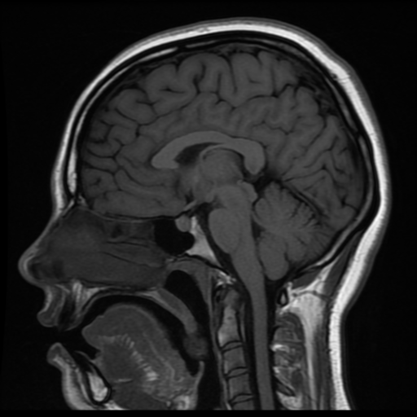
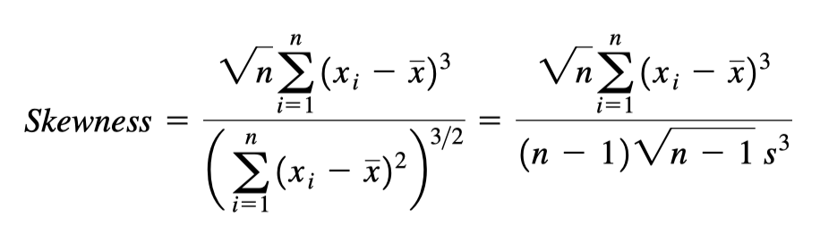
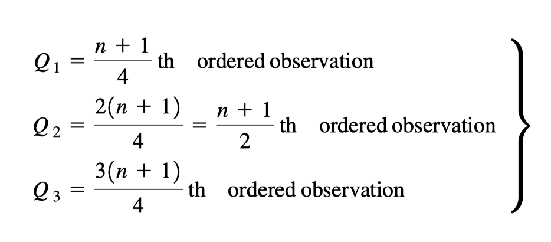

Imágenes
========

**Imagen Sagital**

**Ecuacion 1.**

Medida para evaluar que tan parecido es la distribución de los datos con la distribución normal.

.. image:: kurtosis.png
   :scale: 50%

donde :math:`\bar{x}` es la media y :math:`s` es la desviación estándar

**Ecuacion 2.**

Medida para evaluar que tan simetrica es la distribución de los datos.

donde :math:`\bar{x}` es la media y :math:`s` es la desviación estándar

**Ecuacion 3.**

Formulas para carcular algunos cuartiles.

