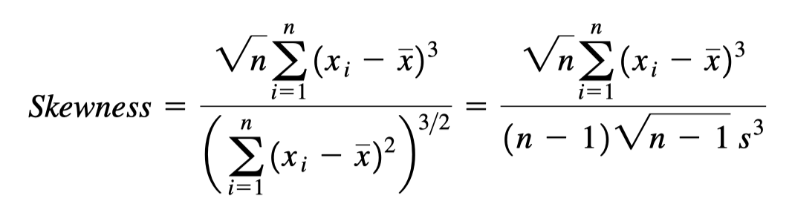
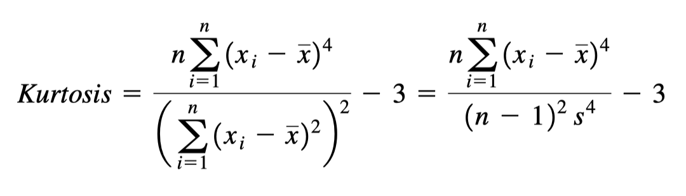

Cálculo de Probabilidades
=========================

A partir de los datos de Edad del Libro "Biostatistics" de Daniel, hacer lo siguiente:

1. Hacer tres graficas en la misma ventana dada por:

   a) Grafica de barras de frecuencias de las edades.
   b) Grafica de barras de las frecuencias relativas de las edades. 
   c) Grafica de barras de las frecuencias relativa acumulada de las edades.

2. Sea X la variable aleatoria que representa la edad de un participante de los 148 que son. 
Encontrar la probabilidad de un participante que sea:

   a) :math:`P(X<40)`

   b) :math:`P(X \leq 40)`

   c) :math:`P(X > 60)`

   d) :math:`P(40 < X < 60)`

3. Tomar 20 muestras de tamaño 10 con reemplazo de las edades (**población**). Para cada muestra calcular 
la media y de todas estas medias calcular la media, (**media-final**). 

**Pregunta:** De cuantas desviaciónes estándar de la población esta la media-final de la media poblacional.

4. Repita el ejercicio 3, tomando como población 100 números enteros de una distribución uniforme 
entre 50 y 60 inclusive.

5. Hacer las funciones en python de las siguientes ecuaciones que se muestran a continuación.

a) Evalua la simetría de la distribución de un vector **x**.

b) Evalua que tan parecida es la distribución de un vector **x** con la  distribución normal.

